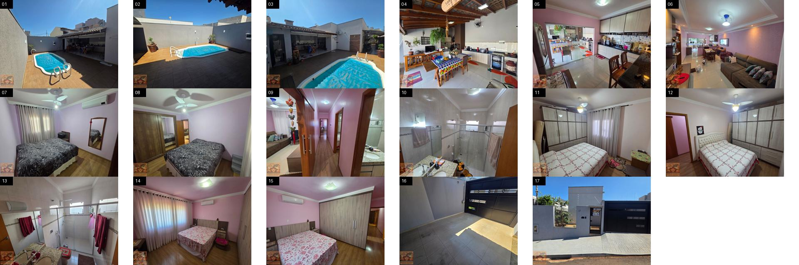

# Motion Reels

Gerador de reels verticais (1080×1920) com mapa animado: a câmera voa entre pontos de interesse reais, mostra rótulos e fotos e termina num cartão final. Pensado para imobiliárias mostrarem o entorno de um imóvel (mercado, escola, praia, banco) em 30 segundos.



## Como funciona

1. **Dados:** os POIs vêm do OpenStreetMap via Overpass API (`pois.json`) e as rotas ficam em `demo/pois_routes.json`.
2. **Animação:** `demo/index.html` usa MapLibre GL para o mapa e GSAP para uma timeline única (`window.tl`) que controla câmera, rótulos e fotos.
3. **Render:** `render.js` abre a página no Chrome headless (Puppeteer), avança a timeline quadro a quadro com `seekTo(t)`, espera o mapa ficar `idle` e tira um screenshot. O ffmpeg junta os quadros em H.264 a 30 fps.

Como cada quadro é renderizado de forma determinística, o vídeo não tem frame drop, mesmo numa máquina lenta.

## Uso

```bash
npm install
npm run serve                  # serve demo/ em http://localhost:8765
node render.js stills 1.8,4.3  # quadros soltos para revisão
npm run video                  # vídeo completo em out/
```

As fotos (`demo/fotos/01..NN.jpg`) e o `logo.png` não estão no repo. Coloque as suas antes de renderizar.

Dados de mapa © colaboradores do OpenStreetMap (ODbL).
